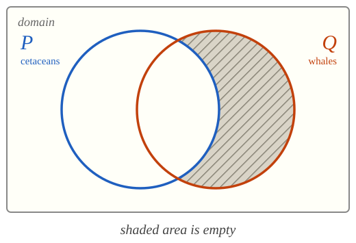
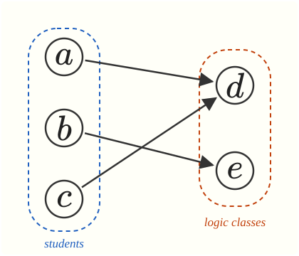
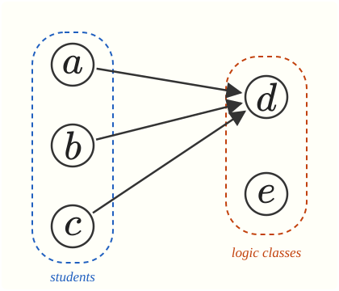

```{=html}
<style>
.v1{color:#1f5fbf;font-weight:600}.v2{color:#c2410c;font-weight:600}
.slot{border:2px dashed #999;border-radius:4px;padding:0 .3em;background:#f6f3e8}
.diagram{display:flex;justify-content:space-around;align-items:flex-start;gap:1.5rem}
.diagram figure{margin:0;text-align:center}.diagram figcaption{font-size:.7em;margin-top:.3em}
.wrong{color:#b91c1c}.right{color:#15803d}
</style>
```

# issues with translation {.divider}

Special quantifier phrases and structural ambiguity.

## overview 

::: {style="height: 40px;"}
:::

1. Some quantifier phrases call for different quantifiers in different contexts: 'a $P$', 'only $P$', 'no $P$', 'any $P$'.

2. Sentences with *multiple quantifiers* often give rise to *structural ambiguity*.

# special quantifier phrases {.divider}

'a $P$', 'only $P$', 'no $P$', and 'any $P$'.

## a $P$

The indefinite article 'a' often gives rise to ambiguity. Context often makes one interpretation more salient than the other:

::: {.columns}
::: {.column width="50%"}
> A whale lives underwater.

> A whale came close to shore.
:::

::: {.column width="50%"}
> *Every* whale lives underwater.
  *Some* whale lives underwater.

> *Some* whale came close to shore.
  *Every* whale came close to shore.
:::
:::

## a whale lives underwater {.smaller}

::: {.columns}
::: {.column width="30%"}


**translation key**

::: {.argument}
Domain: Animals

$Px$: $x$ is a whale

$Qx$: $x$ lives underwater

$Rx$: $x$ came close to shore
:::
:::

::: {.column width="70%"}


::: {.argument}
Every [thing]{.v1} is such that **if** [it]{.v1} is a whale, **then** [it]{.v1} lives underwater.

Every [$x$]{.v1} is such that ([$x$]{.v1} is a whale $\to$ [$x$]{.v1} lives underwater).
:::

::: {.fragment}
$$
\forall x \ (Px \to Qx)
$$
:::
:::
:::

## a whale came close to shore {.smaller}

::: {.columns}
::: {.column width="30%"}
**translation key**

::: {.argument}
Domain: Animals

$Px$: $x$ is a whale

$Qx$: $x$ lives underwater

$Rx$: $x$ came close to shore
:::
:::

::: {.column width="70%"}
::: {.argument}
Some [thing]{.v1} is such that [it]{.v1} is a whale **and** [it]{.v1} came close to shore.

Some [$x$]{.v1} is such that ([$x$]{.v1} is a whale $\wedge$ [$x$]{.v1} came close to shore).
:::

::: {.fragment}
$$
\exists x \ (Px \wedge Rx)
$$
:::
:::
:::

## the unheard interpretations {.smaller}

::: {.columns}
::: {.column width="48%"}
> A whale lives underwater.

::: {.argument}
The syntax is consistent with

$$
\exists x \ (Px \wedge Qx)
$$

but that interpretation is difficult to hear in common contexts.
:::
:::

::: {.column width="48%"}
> A whale came close to shore.

::: {.argument}
The syntax is consistent with

$$
\forall x \ (Px \to Rx)
$$

but that interpretation is difficult to hear in common contexts.
:::
:::
:::

::: {.fragment style="text-align: center;"}
The context, not the grammar, selects the quantifier.
:::


## only cetaceans are whales {.smaller}

::: {.columns}
::: {.column width="30%"}
**translation key**

::: {.argument}
Domain: Animals

$Px$: $x$ is a cetacean

$Qx$: $x$ is a whale
:::
:::

::: {.column width="70%"}

> Only cetaceans are whales.

::: {.argument}
Every whale is a cetacean.

Every [$x$]{.v1} is such that [$x$]{.v1} is a whale **only if** [$x$]{.v1} is a cetacean.

Every [$x$]{.v1} is such that (**if** [$x$]{.v1} is a whale, **then** [$x$]{.v1} is a cetacean).
:::

::: {.fragment}
$$
\forall x \ (Qx \to Px)
$$

{width="300" fig-align="center"}

::: {style="text-align: center;"}
The area of $Q$ outside $P$ is empty.
:::

:::
:::
:::

## a common mistake {.smaller}

::: {.columns}
::: {.column width="48%"}
> Only cetaceans are whales.

::: {.argument}
$$
\forall x \ (Qx \to Px)
$$

Every whale is a cetacean. **True.**
:::
:::

::: {.column width="48%"}
::: {.fragment}
> ~~Only cetaceans are whales.~~

::: {.argument}
::: {style="height: 40px;"}
:::

[$\forall x \ (Px \to Qx)$]{.wrong}

::: {style="height: 3px;"}
:::

Every cetacean is a whale. **False. Dolphins are cetaceans.** 
:::
:::
:::
:::

::: {.fragment}
The mistaken translation turns a **true** sentence into a **false** one. In general:
:::

::: {.fragment style="text-align: center;"}
'Only $P$ are $Q$' reverses the conditional: 'all $Q$ are $P$'.
:::


## only, inside a quantifier {.smaller}

::: {.columns}
::: {.column width="30%"}
**translation key**

::: {.argument}
Domain: Animals

$Qx$: $x$ is a whale

$Rx$: $x$ is krill

$Sxy$: $x$ eats $y$
:::
:::

::: {.column width="70%"}

> Some whales eat only krill.

::: {.argument}
Some [$x$]{.v1} is such that [$x$]{.v1} is a whale **and** [$x$]{.v1} eats only krill.

Some [$x$]{.v1} is such that ([$x$]{.v1} is a whale $\wedge$ [[$x$]{.v1} eats only krill]{.slot}$)$

[$x$]{.v1} eats only krill $\;\leadsto\;$ for every [$y$]{.v2}, ([$x$]{.v1} eats [$y$]{.v2} $\to$ [$y$]{.v2} is krill)

Some [$x$]{.v1} is such that ([$x$]{.v1} is a whale $\wedge$ for every [$y$]{.v2}, ([$x$]{.v1} eats [$y$]{.v2} $\to$ [$y$]{.v2} is krill)).
:::

::: {.fragment}
$$
\exists x \ (Qx \wedge \forall y \ (Sxy \to Ry))
$$
:::
:::
:::

## no $P$ {.smaller}

::: {.columns}
::: {.column width="30%"}
**translation key**

::: {.argument}
Domain: Animals

$Px$: $x$ is a whale

$Qx$: $x$ is a fish
:::
:::

::: {.column width="70%"}

> No whale is a fish. 

::: {.argument}
All whales are **not** fish.

Every [$x$]{.v1} is such that ([$x$]{.v1} is a whale $\to$ $\neg$ [$x$]{.v1} is a fish).
:::

::: {.fragment}
$$
\forall x \ (Px \to \neg Qx)
$$
:::


::: {.fragment}
::: {.argument}
It's **not** the case that some whale is a fish.

$\neg$ some [$x$]{.v1} is such that ([$x$]{.v1} is a whale $\wedge$ [$x$]{.v1} is a fish).
:::
:::

::: {.fragment}
$$
\neg \exists x \ (Px \wedge Qx)
$$
:::
:::
:::

::: {.fragment style="text-align: center;"}
Both translations are acceptable: they are equivalent.
:::


## any {.smaller}

One difficulty with 'any' is that it calls for different quantifiers in different contexts.

::: {.columns}
::: {.column width="30%"}
**translation key**

::: {.argument}
Domain: Animals

$Px$: $x$ is a whale

$Qx$: $x$ breathes air
:::
:::

::: {.column width="70%"}

> Any whale breathes air.

::: {.argument}
All whales breathe air.

Every [$x$]{.v1} is such that ([$x$]{.v1} is a whale $\to$ [$x$]{.v1} breathes air).
:::

::: {.fragment}
$$
\forall x \ (Px \to Qx)
$$
:::
:::
:::


## 'any' in an antecedent {.smaller}

::: {.columns}
::: {.column width="30%"}
**translation key**

::: {.argument}
Domain: Animals

$Px$: $x$ is a whale

$Qx$: $x$ breathes air
:::
:::

::: {.column width="70%"}

> If any whale breathes air, then they all do.

::: {.argument}
**If** some whale breathes air, **then** all whales breathe air.

If (some [$x$]{.v1} is such that ([$x$]{.v1} is a whale $\wedge$ [$x$]{.v1} breathes air) $\to$ every [$x$]{.v1} is such that ([$x$]{.v1} is a whale $\to$ [$x$]{.v1} breathes air).
:::

::: {.fragment}
$$
\exists x \ (Px \wedge Qx) \to \forall x \ (Px \to Qx)
$$

::: {style="text-align: center;"}
Here 'any' becomes $\exists$, not $\forall$.
:::

:::
:::
:::


## 'any' v 'every' {.smaller}

::: {.columns}
::: {.column width="48%"}
> If **any** whale breathes air, then they all do.

::: {.argument}
$$
(\exists x \ (Qx \wedge Rx) \to \forall x \ (Qx \to Rx))
$$

Informative.
:::
:::

::: {.column width="48%"}

> If **every** whale breathes air, then they all do.

::: {.argument}
$$
\forall x \ (Qx \to Rx) \to \forall x \ (Qx \to Rx)
$$

Trivial.
:::
:::
:::


# structural ambiguity {.divider}

Multiple generality and the order of quantifiers.

## there is a cause for everything {.smaller}

::: {.columns}
::: {.column width="30%"}
**translation key**

::: {.argument}
Domain: Events

$Rxy$: $x$ causes $y$
:::
:::

::: {.column width="70%"}

> There is a cause for everything.

::: {.fragment}
There are two candidate interpretations:

::: {.argument}
1. Everything has some cause or other.

2. Some one thing is the cause of everything.
:::
:::
:::
:::

## everything has a cause {.smaller}

::: {.columns}
::: {.column width="30%"}
**translation key**

::: {.argument}
Domain: Events

$Rxy$: $x$ causes $y$
:::
:::

::: {.column width="70%"}

> Everything has a cause.

::: {.argument}
Every [$x$]{.v1} is such that [$x$]{.v1} has a cause.

Every [$x$]{.v1} is such that some [$y$]{.v2} is such that [$y$]{.v2} causes [$x$]{.v1}.
:::

::: {.fragment}
$$
\forall x \ \exists y \ Ryx
$$
:::
:::
:::

## something causes everything {.smaller}

::: {.columns}
::: {.column width="30%"}
**translation key**

::: {.argument}
Domain: Events

$Rxy$: $x$ causes $y$
:::
:::

::: {.column width="70%"}

> Something is a cause of everything.

::: {.argument}
Some [$x$]{.v1} is such that [$x$]{.v1} causes everything.

Some [$x$]{.v1} is such that every [$y$]{.v2} is such that [$x$]{.v1} causes [$y$]{.v2}.
:::

::: {.fragment}
$$
\exists x \ \forall y \ Rxy
$$
:::
:::
:::

## which one is correct?

::: {style="height: 40px;"}
:::

We rely on **contextual cues** to identify the intended interpretation.

In case of doubt, provide **both** translations and explain that the target sentence is ambiguous between them.


## every student must register for some logic class {.smaller}

::: {.columns}
::: {.column width="30%"}
**translation key**

::: {.argument}
Domain: Students and courses

$Px$: $x$ is a student

$Qx$: $x$ is a logic class

$Rxy$: $x$ registers for $y$
:::
:::

::: {.column width="70%"}

> Every student must register for some logic class.

::: {.fragment}
Again a choice between two **non-equivalent** interpretations:

::: {.argument}
1. Each student must register for some logic class or other.

2. There is one logic class every student must register for.
:::
:::
:::
:::

## interpretation 1 {.smaller}

::: {.columns}
::: {.column width="25%"}
**translation key**

::: {.argument}
Domain: Students and courses

$Px$: $x$ is a student

$Qx$: $x$ is a logic class

$Rxy$: $x$ registers for $y$
:::
:::

::: {.column width="75%"}

> Each student must register for some logic class or other.

::: {.argument}
For every [$x$]{.v1}, ([$x$]{.v1} is a student $\to$ [[$x$]{.v1} must register for some logic class]{.slot}$)$

[$x$]{.v1} must register for some logic class $\;\leadsto\;$ for some [$y$]{.v2}, ([$y$]{.v2} is a logic class $\wedge$ [$x$]{.v1} must register for [$y$]{.v2})

Every [$x$]{.v1} is such that ([$x$]{.v1} is a student $\to$ some [$y$]{.v2} is such that ([$y$]{.v2} is a logic class $\wedge$ [$x$]{.v1} must register for [$y$]{.v2})).
:::

::: {.fragment}
$$
\forall x \ (Px \to \exists y \ (Qy \wedge Rxy))
$$
:::
:::
:::

## interpretation 2 {.smaller}

::: {.columns}
::: {.column width="25%"}
**translation key**

::: {.argument}
Domain: Students and courses

$Px$: $x$ is a student

$Qx$: $x$ is a logic class

$Rxy$: $x$ registers for $y$
:::
:::

::: {.column width="75%"}

> There is one logic class every student must register for.

::: {.argument}
For some [$x$]{.v1}, ([$x$]{.v1} is a logic class $\wedge$ [every student must register for [$x$]{.v1}]{.slot}$)$.

every student must register for [$x$]{.v1} $\;\leadsto\;$ for every [$y$]{.v2}, ([$y$]{.v2} is a student $\to$ [$y$]{.v2} must register for [$x$]{.v1})

For some [$x$]{.v1}, ([$x$]{.v1} is a logic class $\wedge$ for every [$y$]{.v2}, ([$y$]{.v2} is a student $\to$ [$y$]{.v2} must register for [$x$]{.v1})).
:::

::: {.fragment}
$$
\exists x \ (Qx \wedge \forall y \ (Py \to Ryx))
$$
:::
:::
:::

## the two interpretations pictured {.smaller}

Students $a$, $b$, $c$; logic classes $d$, $e$. An arrow from $x$ to $y$ means **$x$ registers for $y$**.

::: {.columns}
::: {.column width="48%"}
{width="300" fig-align="center"}

::: {.incremental}
- Interpretation 1: **true**

- Interpretation 2: **false**
:::
:::

::: {.column width="48%"}
{width="300" fig-align="center"}

::: {.incremental}
- Interpretation 1: **true**

- Interpretation 2: **true**
:::
:::
:::

::: {.fragment style="text-align: center;"}
Interpretation 2 entails reading 1, but not conversely.
:::

## no ambiguity here {.smaller}

::: {.columns}
::: {.column width="25%"}
**translation key**

::: {.argument}
Domain: Students and courses

$Px$: $x$ is a student

$Qx$: $x$ is a logic course

$Rxy$: $x$ registers for $y$
:::
:::

::: {.column width="75%"}

> Every student must register for every logic course.

::: {.argument}
For every [$x$]{.v1}, ([$x$]{.v1} is a student $\to$ [[$x$]{.v1} must register for every logic course]{.slot}$)$

[$x$]{.v1} must register for every logic course $\;\leadsto\;$ for every [$y$]{.v2}, ([$y$]{.v2} is a logic class $\to$ [$x$]{.v1} must register for [$y$]{.v2})

For every [$x$]{.v1}, ([$x$]{.v1} is a student $\to$ for every [$y$]{.v2}, ([$y$]{.v2} is a logic course $\to$ [$x$]{.v1} must register for [$y$]{.v2})).
:::

::: {.fragment}
$$
\forall x \ (Px \to \forall y \ (Qy \to Rxy))
$$


:::
:::
:::

## check your translation

Every translation should be a **closed** formula.

```{.QLFormulaChecker card="full" height="520px"}
∃x(Qx ∧ ∀y(Py → Ryx))
```
