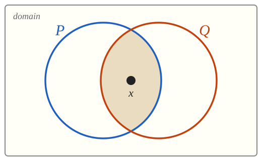
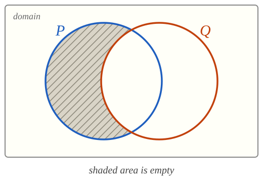
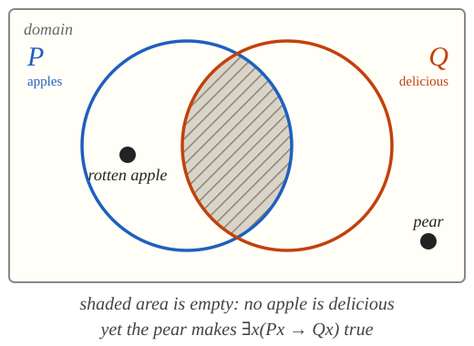
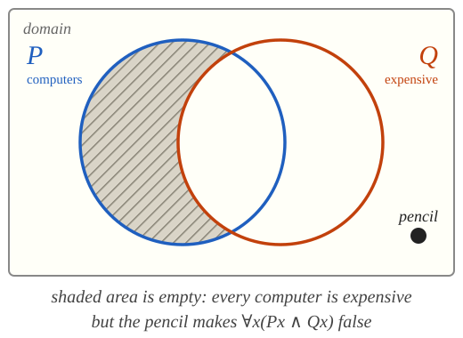
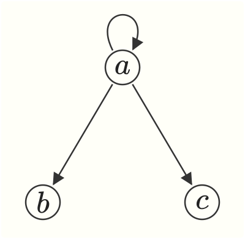
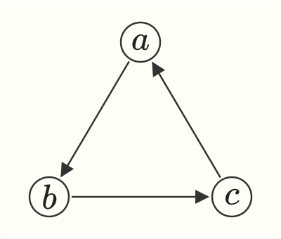

```{=html}
<style>
.v1{color:#1f5fbf;font-weight:600}.v2{color:#c2410c;font-weight:600}
.slot{border:2px dashed #999;border-radius:4px;padding:0 .3em;background:#f6f3e8}
.diagram{display:flex;justify-content:space-around;align-items:flex-start;gap:1.5rem}
.diagram figure{margin:0;text-align:center}.diagram figcaption{font-size:.7em;margin-top:.3em}
.wrong{color:#b91c1c}.right{color:#15803d}
</style>
```

# translation {.divider}

We build on the strategies we used for propositional logic, but now use the vocabulary of quantificational logic to identify further structure.

## the strategy {.smaller}

:::{.argument}
1. We first explain how the target sentence is built from simpler sentences with the help of propositional connectives.

2. We do not let propositional variables to stand for those simpler sentences, but rather use **predicates**, **constants**, **variables**, and **quantifiers** to display their internal structure.
:::

# predication {.divider}

Designators and predicates.

## example {.smaller}

> Aristotle followed Plato, but Plato followed Socrates. Aristotle and Plato followed each other. Therefore, Aristotle followed Socrates only if Plato did.


::: {.argument}
1. Aristotle followed Plato, but Plato followed Socrates.
2. Aristotle and Plato followed each other.
3. Aristotle followed Socrates only if Plato did.
:::

## premise {.smaller}

::: {.columns}
::: {.column width="30%"}
**translation key**

::: {.argument}
Domain: People


$Rxy$: $x$ followed $y$

$a$: Aristotle

$b$: Plato

$c$: Socrates
:::
:::

::: {.column width="70%"}

> Aristotle followed Plato, but Plato followed Socrates.

::: {.argument}
(Aristotle followed Plato $\wedge$ Plato followed Socrates)
:::

::: {.fragment}
$$
(Rab \wedge Rbc)
$$
:::
:::
:::


## premise {.smaller}

::: {.columns}
::: {.column width="40%"}
**translation key**

::: {.argument}
Domain: People


$Rxy$: $x$ followed $y$

$a$: Aristotle

$b$: Plato

$c$: Socrates
:::
:::

::: {.column width="60%"}

> Aristotle and Plato followed each other.

::: {.argument}
(Aristotle followed Plato $\wedge$ Plato followed Aristotle)
:::

::: {.fragment}
$$
(Rab \wedge Rba)
$$
:::
:::
:::


## conclusion {.smaller}

::: {.columns}
::: {.column width="30%"}
**translation key**

::: {.argument}
Domain: People


$Rxy$: $x$ followed $y$

$a$: Aristotle

$b$: Plato

$c$: Socrates
:::
:::

::: {.column width="70%"}

> Aristotle followed Socrates only if Plato did.

::: {.argument}
(Aristotle followed Socrates $\to$ Plato followed Socrates)
:::

::: {.fragment}
$$
(Rac \to Rbc)
$$
:::
:::
:::


# quantification {.divider}

Quantifier phrases require more care. We begin with the simplest cases.

## something {.smaller}

> Something is heavy.

::: {.columns}
::: {.column width="30%"}
**translation key**

::: {.argument}
Domain: Objects


$Px$: $x$ is heavy
:::
:::

::: {.column width="70%"}

::: {style="height: 55px;"}
:::

::: {.argument}
Some [thing]{.v1} is such that [it]{.v1} is heavy.

Some [$x$]{.v1} is such that [$x$]{.v1} is heavy.
:::

::: {.fragment}
$$
\exists x \ Px
$$
:::
:::
:::

> Everything is made of matter.

::: {.columns}
::: {.column width="30%"}
**translation key**

::: {.argument}
Domain: Objects


$Qx$: $x$ is made of matter
:::
:::

::: {.column width="70%"}

::: {style="height: 55px;"}
:::

::: {.argument}
Every [thing]{.v1} is such that [it]{.v1} is made of matter.

Every [$x$]{.v1} is such that [$x$]{.v1} is made of matter.
:::

::: {.fragment}
$$
\forall x \ Qx
$$
:::
:::
:::


## nothing {.smaller}

> Nothing lasts forever.

'Nothing' is not a designator. 

::: {.columns}
::: {.column width="30%"}
**translation key**

::: {.argument}
Domain: Objects


$Rx$: $x$ lasts forever
:::
:::

::: {.column width="70%"}

::: {style="height: 55px;"}
:::

::: {.argument}
Not the case that some [thing]{.v1} is such that [it]{.v1} lasts forever.

$\neg$ some [$x$]{.v1} is such that [$x$]{.v1} lasts forever.
:::

::: {.fragment}
$$
\neg \exists x \ Rx
$$
:::

::: {.argument}
Every [thing]{.v1} is such that [it]{.v1} does **not** last forever.

Every [$x$]{.v1} is such that $\neg$ [$x$]{.v1} lasts forever.
:::

::: {.fragment}
$$
\forall x \ \neg Rx
$$
:::
:::
:::


## some apples are delicious {.smaller}


> Some apples are delicious.

::: {.columns}
::: {.column width="30%"}
**translation key**

::: {.argument}
Domain: Objects


$Px$: $x$ is an apple

$Qx$: $x$ is delicious

:::
:::

::: {.column width="70%"}

::: {style="height: 40px;"}
:::

::: {.argument}
Some [thing]{.v1} is such that [it]{.v1} is an apple and [it]{.v1} is delicious.

Some [$x$]{.v1} is such that ([$x$]{.v1} is an apple $\wedge$ [$x$]{.v1} is delicious).
:::

::: {.fragment}
$$
\exists x \ (Px \wedge Qx)
$$

{width="300" fig-align="center"}

::: {style="text-align: center;"}
The overlap between $P$ and $Q$ is not empty.
:::

:::


:::
:::


## Every computer is expensive {.smaller}


> Every computer is expensive.

::: {.columns}
::: {.column width="30%"}
**translation key**

::: {.argument}
Domain: Objects


$Px$: $x$ is a computer

$Qx$: $x$ is expensive

:::
:::

::: {.column width="70%"}

::: {style="height: 40px;"}
:::

::: {.argument}
Every [thing]{.v1} is such that [it]{.v1} is expensive **if** [it]{.v1} is a computer.

Every [thing]{.v1} is such that **if** [it]{.v1} is a computer, **then** [it]{.v1} is expensive.

Every [$x$]{.v1} is such that ([$x$]{.v1} is a computer $\to$ [$x$]{.v1} is expensive).
:::

::: {.fragment}
$$
\forall x \ (Px \to Qx)
$$

{width="300" fig-align="center"}

::: {style="text-align: center;"}
The area of $P$ outside $Q$ is empty.
:::

:::

:::
:::


## why the difference? {.smaller}

::: {.columns}
::: {.column width="48%"}
$$
\exists x(Px \wedge Qx)
$$

::: {.argument}
$\exists$ generally pairs with $\wedge$

Some apples are delicious

[$\exists x(Px \to Qx)$ ✗]{.wrong}

::: {.fragment}
That corresponds to the claim that **something** is delicious **if** it is an apple. 

A pear makes it true, even if no apples are delicious.


{width="300" fig-align="center"}

:::

:::


:::


::: {.column width="48%"}
$$
\forall x(Px \to Qx)
$$

::: {.argument}

$\forall$ generally pairs with $\to$

Every computer is expensive

[$\forall x(Px \wedge Qx)$ ✗]{.wrong}

::: {.fragment}
That corresponds to **everything** is both a computer and expensive. 

A pencil makes it false even if every computer is expensive.

{width="300" fig-align="center"}

:::
:::

:::

:::


## the network {.smaller}

> Some computers are connected to the network.

::: {.columns}
::: {.column width="30%"}
**translation key**

::: {.argument}
Domain: Objects


$Px$: $x$ is a computer

$Rxy$: $x$ is connected to $y$

$a$: the network

:::
:::

::: {.column width="70%"}

::: {style="height: 40px;"}
:::

::: {.argument}
Some [thing]{.v1} is such that [it]{.v1} is a computer and [it]{.v1} is connected to the network.

Some [$x$]{.v1} is such that ([$x$]{.v1} is a computer $\wedge$ [$x$]{.v1} is connected to $a$).
:::

::: {.fragment}
$$
\exists x \ (Px \wedge Rxa)
$$
:::
:::

:::

> Every computer is connected to the network.

::: {.columns}
::: {.column width="30%"}

:::

::: {.column width="70%"}
::: {.argument}
Every [thing]{.v1} is such that if [it]{.v1} is a computer, then [it]{.v1} is connected to the network.

Every [$x$]{.v1} is such that ([$x$]{.v1} is a computer $\to$ [$x$]{.v1} is connected to $a$).
:::


::: {.fragment}
$$
\forall x \ (Px \to Rxa)
$$
:::
:::
:::


## multiple generality {.smaller}

Multiple generality involves predicates with more than one argument place.

::: {.columns}
::: {.column width="30%"}
**translation key**

::: {.argument}
Domain: people

$Rxy$: $x$ follows $y$

$Px$: $x$ is a philosopher

$Qx$: $x$ is a mathematician

$a$: Aristotle

$b$: Plato
:::

:::

::: {.column width="35%"}
::: {.incremental}
- Aristotle followed Plato.

- $Rab$

- Someone followed Plato.

- $\exists x Rxb$


- Aristotle followed someone.

- $\exists x Rax$

- Everyone followed Plato.

- $\forall x Rxb$

- Aristotle followed everyone.

- $\forall x Rax$
:::
:::

::: {.column width="35%"}
::: {.incremental}
- Someone followed someone.

- $\exists x \exists y Rxy$

- Someone followed everyone.

- $\exists x \forall y Rxy$

- Everyone followed someone.

- $\forall x \exists y Rxy$

- Everyone followed everyone.

- $\forall x \forall y Rxy$
:::
:::
:::


## the order of quantifiers {.smaller}


Consider a domain of three individuals $a$, $b$, $c$. We use an arrow from $x$ to $y$ to represent the fact that **$x$ followed $y$**.


::: {.columns}
::: {.column width="48%"}
{width="200" fig-align="center"}

::: {.incremental}
- $\exists x \forall y Rxy$ 

- **True**. $a$ followed *every* individual, including $a$ itself.

- $\forall x \exists y Rxy$

- **False**. Neither $b$ nor $c$ followed anyone.
:::
:::
::: {.column width="48%"}

{width="200" fig-align="center"}


::: {style="height: 30px;"}
:::

::: {.incremental}
- $\exists x \forall y Rxy$ 

- **False**. No individual followed *every* individual.

- $\forall x \exists y Rxy$

- **True**. Everyone followed someone.
:::
:::
:::


## multiple generality {.smaller}

Multiple generality involves predicates with more than one argument place.

::: {.columns}
::: {.column width="30%"}
**translation key**

::: {.argument}
Domain: people

$Rxy$: $x$ follows $y$

$Px$: $x$ is a philosopher

$Qx$: $x$ is a mathematician

$a$: Aristotle

$b$: Plato
:::

:::

::: {.column width="70%"}
::: {.incremental}
- Some philosopher followed Plato.

- $\exists x (Px \wedge Rxb)$

- Plato followed some philosophers.

- $\exists x (Px \wedge Rbx)$


- Every philosopher followed Plato

- $\forall x (Px \to Rxb)$

- Plato followed every philosopher

- $\forall x (Px \to Rbx)$

- No philosopher followed Plato

- $\neg \exists x (Px \wedge Rxb)$

- $\forall x (Px \to \neg Rxb)$

:::
:::
:::


## outside in {.smaller}

> Every philosopher followed some mathematicians.

::: {style="height: 30px;"}
:::

We proceed in three steps:

::: {.incremental}
- We translate the **outer** phrase first:

  $\forall x(Px \to$ [[$x$]{.v1} followed some mathematician]{.slot}$)$

::: {style="height: 20px;"}
:::

- Translate the box on its own:

  [$x$]{.v1} followed some mathematician $\;\leadsto\;$ $\exists y(Qy \wedge R$[$x$]{.v1}[$y$]{.v2}$)$
  
::: {style="height: 20px;"}
:::
  
- Plug the partial translation back in: 

    $\forall x(Px \to \exists y(Qy \wedge Rxy))$
:::

## some philosophers, every mathematician {.smaller}

> Some philosophers followed every mathematician.

::: {.incremental}
- We translate the **outer** phrase first:

  $\exists x(Px \ \wedge$ [[$x$]{.v1} followed every mathematician]{.slot}$)$

::: {style="height: 20px;"}
:::

- Translate the box on its own:

  [$x$]{.v1} followed every mathematician $\;\leadsto\;$ $\forall y(Qy \to R$[$x$]{.v1}[$y$]{.v2}$)$
  
::: {style="height: 20px;"}
:::
  
- Plug the partial translation back in: 

    $\exists x(Px \wedge \forall y(Qy \to Rxy))$
:::


## every philosopher, every mathematician {.smaller}

> Every philosopher followed every mathematician.


::: {.incremental}
- We translate the **outer** phrase first:

  $\forall x(Px \ \to$ [[$x$]{.v1} followed every mathematician]{.slot}$)$

::: {style="height: 20px;"}
:::

- Translate the box on its own:

  [$x$]{.v1} followed every mathematician $\;\leadsto\;$ $\forall y(Qy \to R$[$x$]{.v1}[$y$]{.v2}$)$
  
  
::: {style="height: 20px;"}
:::
  
- Plug the partial translation back in: 

    $\forall x(Px \to \forall y(Qy \to Rxy))$
:::


## how to translate back to English {.smaller}

What claims do these make? 

::: {.columns}
::: {.column width="25%"}
**translation key**

::: {.argument}
Domain: people

$Rxy$: $x$ follows $y$

$Px$: $x$ is a philosopher
:::

:::

::: {.column width="75%"}

::: {style="height: 40px;"}
:::

| | |
|---|---|
| $\exists x \forall y Ryx$ | [Someone is followed by everyone.]{.fragment} |
| $\forall y \exists x Rxy$ | [Everyone is followed by someone.]{.fragment} |
| $\neg \exists x(Px \wedge Rxx)$ | [No philosophers followed themselves.]{.fragment} |
| $\forall x(Px \to \exists y(Py \wedge Ryx))$ | [Every philosopher is followed by some philosopher.]{.fragment} |
:::
:::


